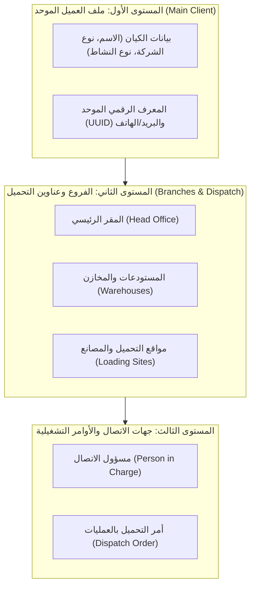

# وثيقة المواصفات الفنية وتطوير وحدة العملاء والعمليات
## مشروع تفكيك وتحليل متطلبات نظام إدارة الملاحة والشحن اللوجستي — الجلسة الفنية الثانية

---

### 📌 بيانات الجلسة والاعتماد
- **الموديول المستهدف:** إدارة العملاء والعمليات (`CRM & Operations`)
- **تاريخ الجلسة:** سبتمبر / أكتوبر 2026
- **حالة المراجعة:** اعتماد المواصفات للتنفيذ الهندسي
- **المصادر الصوتية والمستندية:** تفريغ التسجيل الصوتي لموديول العملاء والعمليات + وثيقة متطلبات وحدة العملاء والعمليات المعتمدة.

---

## الملخص التنفيذي للنموذج (Executive Summary)

تتناول هذه الوثيقة التفريغ الشامل والتحليل الهندسي للتسجيل الصوتي الخاص بإعادة هيكلة موديول **"العملاء والعمليات" (CRM & Operations)** في نظام الملاحة والشحن. 

الهدف الرئيسي هو **إلغاء النموذج القديم (سريع ليد vs رسمي عميل معتمد)**، وتبسيط إدخال البيانات المبدئية للشريك التجاري دون تعقيدات ورقية مسبقة، مع إرساء **الفصل القاطع بين العملاء المستهدفين (Prospects)** و**العملاء الفعليين (Actual Clients)**. يتم **التحويل التلقائي والفوري بمجرد قبول أول عرض سعر (Offer Accepted)** لترحيل العميل إلى جدول المرجعيات (`Master Data`) لاستكمال الملف القانوني والتشغيلي (السجل التجاري، البطاقة الضريبية، الفروع وعناوين التحميل) لتغذية موديول العمليات (`Operations`) مباشرة.

---

## 1. نظرة عامة وخريطة موديول العملاء والعمليات (OVERVIEW)

يتكون موديول العملاء والعمليات من منظومة متكاملة تضمن سرعة استقطاب العملاء وسلاسة تدفق عروض الأسعار حتى تحويلها لأوامر تشغيلية. يوضح الجدول التالي الحالة الحالية والإجراء المعتمد لكل تبويب:

| التبويب الفرعي | الحالة الحالية | نوع الإجراء | ملخص التعديل المطلوب |
|---|---|---|---|
| **العملاء المستهدفون (Prospects)** | نموذج مزدوج ومشتت | `هيكلية جديدة` | شاشة موحدة للشركاء المحتملين مع زر طلب عرض سعر مباشر (`New Offer`) وتتبع الحالات. |
| **العملاء الفعليون (Actual Clients)** | دمج عشوائي مع الليدز | `أتمتة وترقية` | حصر العملاء الذين لديهم عرض سعر مقبول على الأقل، والترحيل التلقائي لملف المرجعيات. |
| **شاشة الإضافة السريعة (Quick Entry)** | تطلب مستندات رسمية مسبقاً | `تجريد وتسهيل` | إلغاء طلب السجل والبطاقة مرحلياً، والاعتماد على اسم المنشأة، نوع الشركة، ونوع النشاط. |
| **دورة حياة العرض (Offer Workflow)** | منفصلة عن سجل العميل | `مسار رقمي` | دورة متكاملة: طلب العرض ⬅ التسعير وإصدار PDF ⬅ القبول وفتح عملية تشغيلية (`Job`). |
| **نموذج طلب العرض (Offer Parameters)** | حقول جامدة بدون خيارات | `حقول ديناميكية` | تحديد مرن للخدمات (شحن/تخليص/نقل)، موانئ POL/POD مقترحة، وعناوين تحميل مشروطة. |
| **الوثائق الرسمية والتنبيهات** | غير مفعلة في بروفايل العميل | `ربط تنبيهات` | إدراج السجل التجاري والبطاقة الضريبية وسجل المستوردين مع محرك التنبيهات (`Alarms`). |
| **الفروع وعناوين التحميل** | عنوان أحادي مسطح | `ربط تشغيلي` | دعم الفروع المتعددة ومسؤولي الاتصال، والاستدعاء المباشر في أمر التحميل (`Dispatch Order`). |

> [!IMPORTANT]
> **ملاحظة برمجية ومعمارية حاسمة (فرق المرجعيات):**
> تم التأكيد المشدد على أن **نوع الشركة (`Company Type`)** يختلف تماماً برمجياً وتشغيلياً عن **نوع النشاط / التصنيف (`Industry Sector`)**؛ حيث يمكن لمصنع ولموزع أن يعملا كلاهما في قطاع "الأغذية" (مصنع أغذية وموزع أغذية). لذلك تم إقرار بناء شاشتين ومكتبتين مستقلتين في موديول المرجعيات لكل منهما لتمكين التخصيص الحر.

---

## 2. التحليل التفصيلي: سجل العملاء وشاشة الإضافة السريعة (DETAILED SPECS - PART 1)

### أولاً: الهيكلية الجديدة لسجل العملاء (Directory Architecture)
إلغاء المفهوم القديم بوجود نموذجين للإضافة (إضافة عميل معتمد vs إضافة ليد سريع)، واعتماد تبويبين رئيسيين ينظمان حركة العملاء:

#### 1. قسم العملاء المستهدفين (`Prospects / Leads`):
- **التصنيف:** شاشة مخصصة لجميع الشركاء المحتملين الجدد دون استثناء.
- **طريقة الإضافة:** زر موحد **"إضافة عميل / ليد جديد"** عبر نموذج إدخال مبسط وسريع جداً وخالٍ من التعقيدات الرسمية.
- **الوظيفة الأساسية:** زر **"طلب عرض سعر جديد" (`New Offer`)** مباشرة داخل ملف العميل، مع تتبع كامل لحالة العرض.
- **قاعدة البيانات:** تخزين مبدئي بصفة `status = prospect`.

#### 2. قسم العملاء الفعليين (`Actual Clients`):
- **معيار التصنيف:** العميل الذي قام بتأكيد وقبول عرض سعر واحد على الأقل (`Accepted Offer`).
- **آلية التحويل:** تحويل ونقل آلي ومباشر فور قيام العميل بالموافقة والضغط على زر `Accept Offer` دون تدخل يدوي.
- **التكامل مع المرجعيات:** ترحيل العميل فورياً لسجل المرجعيات (`Master Data`) لاستكمال الملف القانوني والتشغيلي.
- **الفتح التشغيلي:** إنشاء ملف عملية تشغيلية تلقائياً (`Operation Job File`).

---

### ثانياً: شاشة الإضافة السريعة وإعدادات المرجعيات (Quick Entry & Lookups)
تم تصميم نافذة الإضافة السريعة لتركز فقط على بيانات التواصل والتصنيف المبدئي مع استبعاد البيانات القانونية مرحلياً.

### ثالثاً: مصفوفة حقول شاشة الإضافة السريعة للعميل (FIELD MAPPING)

| اسم الحقل | نوع الحقل | مصدر البيانات / المكتبة | التغيير المعتمد وشروط الإدخال |
|---|---|---|---|
| **اسم المنشأة / الشركة (عربي)** | نصي (`Text Input`) | إدخال مباشر | حقل إجباري لتحديد هوية الكيان التجاري محلياً. |
| **اسم المنشأة / الشركة (إنجليزي)** | نصي (`Text Input`) | إدخال مباشر | حقل إجباري لا غنى عنه لإصدار بوالص الشحن وعروض الأسعار. |
| **السجل التجاري والبطاقة الضريبية** | رقمي / مرفق | غ/م (ملغى في الإضافة السريعة) | ~~حذف كامل من شاشة الإضافة السريعة~~ (يطلب مرحلياً لاحقاً في المرجعيات). |
| **نوع الشركة (`Company Type`)** | قائمة منسدلة (`Select`) | مكتبة أنواع الشركات (`Company Types`) | ربط بمكتبة ديناميكية (مصنع، تاجر، موزع، مستورد...). |
| **نوع النشاط / التصنيف (`Sector`)** | قائمة منسدلة (`Select`) | مكتبة قطاعات الأعمال (`Industry Sectors`) | ربط بمكتبة ديناميكية (مواد غذائية، هندسي، كيميائي، ملابس...). |
| **الموقع الجغرافي (الدولة / المدينة)** | قائمة مدمجة (`Combo`) | جدول أطلس الدول والمدن | تحديد البلد والمدينة بدقة لتوزيع التغطية الجغرافية والتسعير. |
| **بيانات الاتصال السريعة** | مجموعة حقول نصية | إدخال مباشر | رقم الهاتف، البريد الإلكتروني، واسم المسؤول (`Person in Charge`). |
| **الموقع الإلكتروني (`Website`)** | رابط (`URL Input`) | إدخال اختياري | حقل إضافي لتوثيق المنصة الرقمية للعميل. |

---

## 3. دورة حياة العرض ونموذج تسعير الشحنات (OFFER WORKFLOW & PARAMETERS)

### أولاً: دورة حياة طلب وعرض السعر (New Offer Workflow)
يمر طلب السعر بدورة رقمية متكاملة تضمن دقة التسعير وسرعة الاستجابة وربط المبيعات بالعمليات:

1. **المرحلة 1: إنشاء الطلب (`New Offer Request`):**
   الضغط على زر `New Offer` داخل ملف العميل وتعبئة البيانات التشغيلية الأولية وإرسالها لطابور التسعير.
2. **المرحلة 2: التسعير والعرض (`Pricing & PDF Generation`):**
   يقوم فريق التسعير بتسعير البنود، وتتحول الحالة إلى `Completed` مع توليد عرض سعر رسمي PDF قابل للإرسال.
3. **المرحلة 3: القبول والتشغيل (`Acceptance & Launch`):**
   بمجرد قبول العرض (`Accepted`)، يتم ترقية العميل إلى "فعلي" وفتح ملف عملية تشغيلية (`Operation Job`) فوراً.

### ثانياً: حقول وشروط نموذج عرض السعر (Offer Parameters)

| العنصر / الحقل | الخيارات وآلية الإدخال | الشروط البرمجية وقواعد الربط |
|---|---|---|
| **نوع الشحنة (`Service Type`)** | نقل بري / تخليص جمركي / شحن بحري أو جوي (تحديد متعدد) | دمج أي 1 أو 2 أو الـ 3 خدمات معاً. اختيار الخدمة يفتح حقولاً ديناميكية خاصة بها تلقائياً. |
| **موانئ الشحن والتفريغ (`POL / POD`)** | ميناء الشحن (`POL`) وميناء الوصول والتفريغ (`POD`) | اقتراح تلقائي (`Auto-suggest`) من سجل الموانئ المعتمد بالنظام بمجرد الكتابة. |
| **ميناء التخليص وعنوان التحميل** | قوائم موانئ + عناوين الفروع المسجلة أو إدخال يدوي | تظهر حقول ميناء التخليص عند اختيار "التخليص"، ويظهر عنوان التحميل عند اختيار "النقل البري". |
| **تفاصيل البضاعة والحاوية** | وصف البضاعة + نوع الحاوية (20ft, 40ft, 40HQ) + الكمية | إدخال تفصيلي للحاويات ومواصفات البضاعة لتمكين فريق التسعير من احتساب الأوزان والمساحات. |
| **ملاحظات التسعير (`Notes`)** | حقل نصي متقدم (`Special Requirements`) | توجيه المتطلبات الخاصة والحساسة مباشرة إلى مسؤولي التسعير (`Pricing Desk`). |

### ثالثاً: صيغة سطر الملخص التشغيلي في ملف العميل (Dashboard Line Summary)
```text
1x40' | From: Alexandria ➔ To: Mersin | Service: Transport & Freight | Qty: 3 | [Offer #1024] View PDF | Status: Completed
```

---

## 4. الملف الفعلي للعميل بالمرجعيات، الفروع، وتكامل العمليات (MASTER INTEGRATION & OPERATIONS)

بمجرد تحول العميل إلى "عميل فعلي"، ينتقل ملفه إلى شاشة المرجعيات ليقوم مسؤول التشغيل (`Operator`) باستكمال البيانات القانونية والمكانية الضرورية لتنفيذ الشحنات:

### أولاً: المستندات الرسمية ومحرك التنبيهات (`Documents & Alarms`):
- **رفع السجلات الرسمية:** إمكانية رفع ملفات PDF وصور لـ:
  - السجل التجاري (`Commercial Register`).
  - البطاقة الضريبية (`Tax ID`).
  - سجل المستوردين / المصدرين (`Importer/Exporter Registry`).
- **تواريخ الانتهاء والصلاحية:** حقول مخصصة لكل وثيقة لتسجيل تاريخ انتهاء الصلاحية الفعلي.
- **الربط بمحرك التنبيهات (`Alarms Engine`):** إطلاق إنذارات تلقائية مبكرة قبل انتهاء الوثيقة بمدة محددة لتفادي إيقاف التخليص الجمركي للشحنات.

### ثانياً: الفروع وعناوين التحميل (`Branches & Dispatch Sites`):
- **تعدد الفروع والمخازن:** إضافة عدة عناوين وفروع للعميل تشمل (المقر الرئيسي، المخازن والمستودعات، مواقع التحميل والمصانع).
- **جهات الاتصال التفصيلية:** إضافة مسؤولي اتصال (`Persons in Charge`) بكل فرع متضمنين: الاسم، المسمى الوظيفي، الهاتف، والبريد المباشر.
- **الربط المباشر بأمر التحميل:** استدعاء هذه العناوين بضغطة زر داخل **أمر التحميل (`Pickup / Dispatch Order`)** في موديول العمليات دون إعادة إدخال يدوي.

---

## 5. هيكلية البيانات الهرمية وتكامل المنظومة (DATA ARCHITECTURE)



---

## 6. الربط مع محرك التنبيهات وإدارة المكتبات المرجعية (SYSTEM ENGINE IMPACT)

### 1. محرك التنبيهات والإنذارات الموحد (`Alarm & Alert System Integration`):
يتم تجميع كافة التواريخ القانونية للعميل وربطها بنظام المراقبة الاستباقي للشركة:
- **تاريخ انتهاء السجل التجاري للعميل:** إشعار مبكر قبل 30 يوماً.
- **تاريخ انتهاء البطاقة الضريبية:** إشعار مبكر للقسم المالي والقانوني.
- **تاريخ صلاحية سجل المصدرين والمستوردين:** حظر تلقائي لإنشاء بوالص جديدة في حال انتهاء السجل.

### 2. جدول المكتبات المرجعية الواجب استحداثها للعملاء (`Global Master Libraries`):

| اسم المكتبة المرجعية | الشاشات والعمليات المستفيدة | أمثلة للبيانات القابلة للإضافة والتعديل |
|---|---|---|
| **مكتبة أنواع الشركات (`Company Types`)** | الإضافة السريعة، بروفايل العميل، المرجعيات | مصنع، تاجر تجزئة، تاجر جملة، موزع معتمد، مستورد، مصدر، وكيل تجاري. |
| **مكتبة قطاعات الأعمال (`Industry Sectors`)** | تصنيف العملاء، تقارير المبيعات، عروض الأسعار | صناعات غذائية، هندسية، كيميائية، غزل ونسيج، أدوات صحية، أجهزة كهربائية. |
| **مكتبة وثائق وتراخيص الكيانات** | محرك التنبيهات، بروفايل المرجعيات للعميل | سجل تجاري، بطاقة ضريبية، سجل مصدرين، سجل مستوردين، بطاقة متعاملين جمركية. |
| **مكتبة تصنيفات الفروع والمواقع** | أوامر التحميل (`Dispatch`)، النقل البري | المقر الرئيسي، مستودع مركزي، مصنع / موقع إنتاج، معرض توزيع، رصيف ميناء. |

---

### 📂 روابط الملفات المنشأة:
- **ملف PDF جاهز للطباعة والتحميل:** [وثيقة_المواصفات_الفنية_وتطوير_وحدة_العملاء_والعمليات.pdf](file:///c:/Users/omara/Videos/redshipping/docs/وثيقة_المواصفات_الفنية_وتطوير_وحدة_العملاء_والعمليات.pdf)
- **ملف HTML تفاعلي بتنسيق مطابق للأصل:** [CLIENTS_OPS_SPECIFICATIONS.html](file:///c:/Users/omara/Videos/redshipping/docs/CLIENTS_OPS_SPECIFICATIONS.html)
